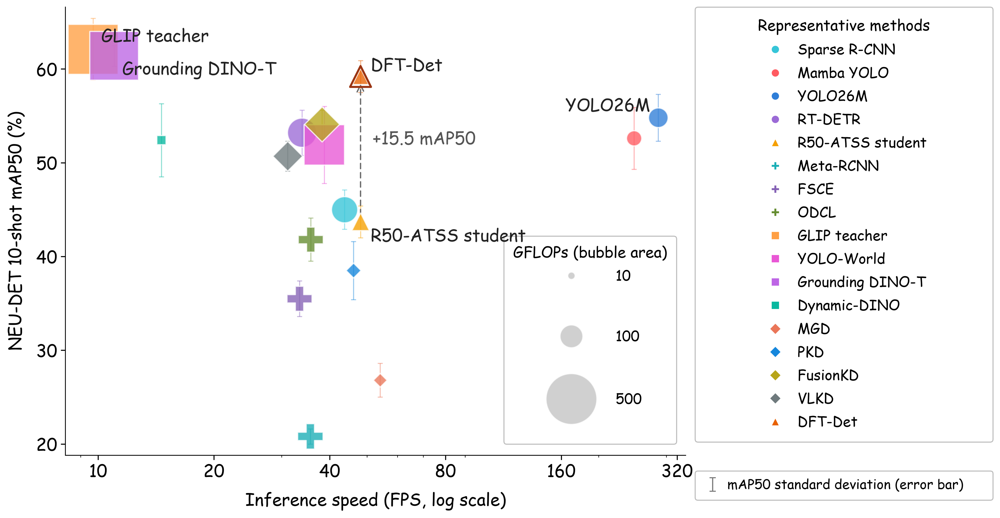

# DFT-Det

<p align="center">
  <strong>DFT-Det: Knowledge-Form Scheduling for Few-Shot Industrial Defect Detection</strong>
</p>

<p align="center">
  <a href="https://github.com/SZDHCUSZZ/DFT-Det">GitHub Repository</a>
</p>


This repository contains the official implementation of **DFT-Det**, a few-shot industrial defect detector that treats frozen and few-shot fine-tuned states of the same vision-language model (VLM) as complementary knowledge forms.

> **Note:** The result figure is referenced as `fig/Fig7.png`. Please copy the local figure to `code/fig/Fig7.png` before uploading the repository to GitHub.



## Abstract

Few-shot industrial defect detection is constrained by scarce bounding-box annotations and subtle defect appearances. Vision-language models (VLMs) provide transferable semantic priors, but their use as teachers creates a freeze--finetune dilemma: a frozen teacher preserves general knowledge yet hallucinates under natural-to-industrial domain shift, whereas a few-shot fine-tuned teacher better matches the target label space but overfits and forgets generalizable knowledge. We propose **DFT-Det**, which treats these two states of the same VLM as complementary knowledge forms with distinct yet correlated errors. **Cross-Modal Semantic Bridging** performs response-weighted semantic and geometric alignment to reduce indiscriminate feature transfer. **Offline-Form Bias Correction** bounds supervision from fine-tuned teacher predictions while retaining informative uncertainty. **Progressive Anchor-Conditioned Knowledge-Form Scheduling** combines a stage-wise curriculum prior with anchor-conditioned residual gates inferred from detached student features, progressively redistributing online semantic distillation and offline structured supervision. Across 1-, 5-, and 10-shot settings on NEU-DET, PKU-PCB, and our class-imbalanced Lens dataset, DFT-Det improves the undistilled student by 16.4 $\mathrm{mAP}_{0.5}$ points on average and outperforms the strongest controlled distillation baseline by 5.8 points, while approaching the VLM teacher's accuracy at 48.1 FPS.

## Method Overview

DFT-Det consists of three complementary components:

1. **Cross-Modal Semantic Bridging (CMSB)** aligns student visual features with VLM semantic representations using response-aware semantic and geometric signals.
2. **Offline-Form Bias Correction (OFBC)** constrains supervision from the few-shot fine-tuned teacher, preventing unreliable predictions from dominating training while preserving useful uncertainty.
3. **Progressive Anchor-Conditioned Knowledge-Form Scheduling (PACKS)** combines a stage-wise scheduling prior with residual anchor gates computed from detached student features. This progressively balances online semantic distillation and offline structured supervision.

## Repository Structure

```text
DFT-Det/
├── configs/              # Training and model configurations
├── mmdet/                # MMDetection framework and DFT-Det modules
├── tools/                # Training, testing, and evaluation tools
├── scripts/              # Lightweight utility scripts
├── checkpoint/           # Local directory for downloaded checkpoints
├── datasets/             # Local directory for datasets
├── fig/                  # Figures used in this README
├── requirements.txt      # Python dependencies
├── setup.py
└── README.md
```

The repository intentionally excludes datasets, model weights, generated predictions, logs, and experiment outputs.

## Installation

The implementation is based on MMDetection 3.0.0rc6 and was developed with Python 3.8, PyTorch 1.12.1, CUDA 11.3, MMCV 2.0.0rc4, and MMEngine 0.7.3.

```bash
conda create -n dftdet python=3.8 -y
conda activate dftdet

conda install pytorch==1.12.1 torchvision==0.13.1 torchaudio==0.12.1 \
    cudatoolkit=11.3 -c pytorch
pip install -U openmim
mim install "mmengine==0.7.3"
mim install "mmcv==2.0.0rc4"
pip install -v -e .
```

Alternatively, install the listed dependencies with:

```bash
pip install -r requirements.txt
```

## Data Preparation

Prepare each dataset in COCO format. The dataset root and annotation paths are configured in the selected configuration file. Before training, update the following settings for your environment:

- dataset root and image prefixes;
- category names and number of classes;
- pretrained VLM checkpoint path;
- output working directory.

For a new industrial dataset, update the `metainfo` definition in the relevant configuration and ensure that the annotation category IDs match the class order.

## Pretrained VLM

Download the required VLM checkpoint separately and place it under `checkpoint/`, or provide an absolute path through the configuration. Model weights are not redistributed in this repository.

## Training

From the repository root, run:

```bash
python tools/train.py configs/fusionkd/fusionkd_r50_atss_glip_fpn_1x_coco.py
```

For distributed training:

```bash
./tools/dist_train.sh \
    configs/fusionkd/fusionkd_r50_atss_glip_fpn_1x_coco.py 4
```

The configuration should be adapted to the target dataset before launching an experiment.

## Evaluation

```bash
python tools/test.py \
    configs/fusionkd/fusionkd_r50_atss_glip_fpn_1x_coco.py \
    /path/to/checkpoint.pth
```

## Reproducibility

For reproducible results, record the dataset split, shot count, random seed, checkpoint versions, GPU and CUDA versions, and the exact configuration used for each run.

## Citation

The citation entry will be added when the final bibliographic information is available.

## Acknowledgements

This project is built upon [MMDetection](https://github.com/open-mmlab/mmdetection) and the official [GLIP](https://github.com/microsoft/GLIP) implementation. We thank the authors and contributors of these projects.

## License

This project is released under the [Creative Commons Attribution-NonCommercial 4.0 International License](https://creativecommons.org/licenses/by-nc/4.0/). Commercial use requires separate permission.

## Contact

For questions and collaboration, please use the [GitHub repository](https://github.com/SZDHCUSZZ/DFT-Det).
